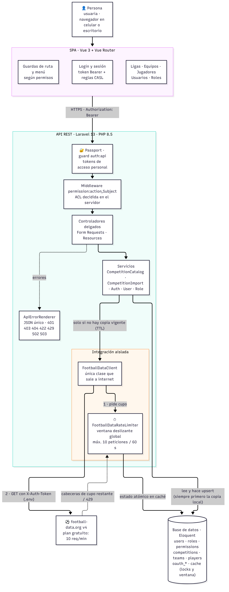
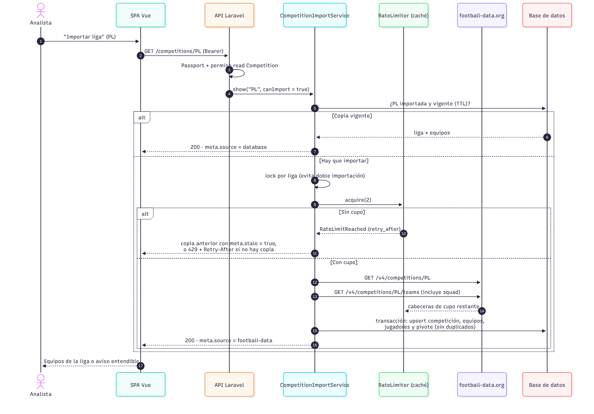
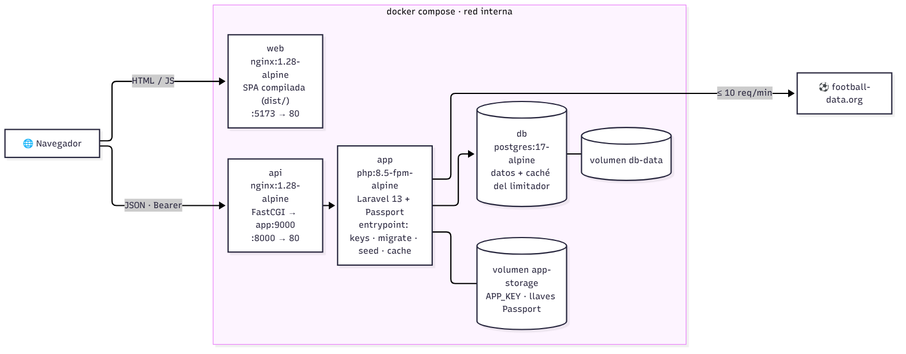

# Plataforma de fútbol — Prueba técnica Senior Full Stack (Inca Rail)

Una API REST en **Laravel 13 (PHP 8.5)** con **Passport** y una **SPA en Vue 3 + Vue Router** para consultar ligas, equipos y jugadores de [football-data.org](https://www.football-data.org). La API guarda una copia propia de lo que se consulta y controla qué puede hacer cada usuario mediante roles y permisos.

| Carpeta | Contenido |
|---|---|
| [`backend/`](backend) | API Laravel 13 · Passport · Eloquent (SQLite por defecto) |
| [`frontend/`](frontend) | SPA Vue 3 · Vue Router · Vite |
| [`docs/`](docs) | Diagramas de arquitectura (PNG, SVG y fuente Mermaid `.mmd`) |
| [`compose.yml`](compose.yml) | Todo el proyecto en Docker: PostgreSQL · PHP-FPM 8.5 · Nginx · SPA |
| [`.github/workflows/ci.yml`](.github/workflows/ci.yml) | CI: estilo, migraciones, prueba de humo, build y arranque en Docker |
| [`scripts/smoke-test.sh`](scripts/smoke-test.sh) | Prueba de humo de la API (la usa la CI) |
| [§7 Cumplimiento](#7-cumplimiento-del-enunciado) | Matriz requisito → implementación → verificación |

---

## 1. Cómo ejecutarlo

Hay dos formas. **Docker es la recomendada**, porque no necesitas tener PHP 8.5 instalado.

### Opción A — Docker (recomendada)

Requisitos: Docker con Compose v2 (Docker Desktop en Windows o macOS, Docker Engine en Linux).

```bash
cp .env.example .env        # pega tu FOOTBALL_DATA_TOKEN en .env
docker compose up -d --build
```

| Servicio | URL | Qué es |
|---|---|---|
| `web` | <http://localhost:5173> | SPA compilada, servida por Nginx |
| `api` | <http://localhost:8000> | Nginx → PHP-FPM 8.5 (Laravel) |
| `app` | — | PHP-FPM 8.5 sobre Alpine Linux |
| `db` | — | PostgreSQL 17 |

Al arrancar por primera vez, el contenedor `app` hace solo lo necesario (ver [`backend/docker/entrypoint.sh`](backend/docker/entrypoint.sh)):
- genera la `APP_KEY` y las llaves de Passport y las guarda en un volumen;
- espera a la base de datos y ejecuta las migraciones;
- siembra los roles y usuarios de prueba, una sola vez;
- cachea la configuración y las rutas.

Reiniciarlo no pierde datos ni vuelve a sembrar. Si cambias el token en `.env`, aplica el cambio con `docker compose up -d`.

```bash
docker compose logs -f app       # ver qué pasa al arrancar
docker compose down              # apagar (conserva datos)
docker compose down --volumes    # apagar y borrar base de datos y llaves
```

> Los puertos se cambian con `API_PORT` y `WEB_PORT` en `.env`. La SPA se compila apuntando a `http://localhost:${API_PORT}`.

### Opción B — Sin Docker

#### Requisitos

| Herramienta | Versión |
|---|---|
| PHP | **8.5** con las extensiones `pdo_sqlite` (o la de tu BD), `openssl`, `mbstring`, `sodium`, `fileinfo`, `dom`, `curl` |
| Composer | 2.x |
| Node.js | 20.19+ o 22.12+ (con npm) |
| Token de football-data.org | Gratuito: crea una cuenta en <https://www.football-data.org/client/register> |

No hace falta un motor de base de datos aparte: por defecto se usa **SQLite**. Para usar MySQL, PostgreSQL o SQL Server solo hay que cambiar las variables `DB_*` del `.env`, porque todo el acceso a datos pasa por Eloquent y migraciones.

#### Backend (API) — terminal 1

```bash
cd backend
composer install
composer setup          # crea .env, APP_KEY, llaves de Passport, la BD SQLite, migra y siembra
```

Abre `backend/.env` y pega tu token:

```dotenv
FOOTBALL_DATA_TOKEN=tu_token_de_football_data
```

```bash
php artisan serve       # http://localhost:8000
```

`composer setup` ejecuta, en orden, estos pasos (también se pueden correr a mano):

```bash
cp .env.example .env
php artisan key:generate
php artisan passport:keys            # llaves RSA en storage/ (no se suben al repo)
touch database/database.sqlite
php artisan migrate --seed           # tablas + roles, permisos, usuarios y cliente de Passport
```

#### Frontend (SPA) — terminal 2

```bash
cd frontend
cp .env.example .env    # VITE_API_URL=http://localhost:8000
npm install
npm run dev             # http://localhost:5173
```

Para generar la versión de producción: `npm run build` (queda en `frontend/dist`).

> Si la SPA se sirve desde otra URL, agrégala a `CORS_ALLOWED_ORIGINS` en `backend/.env`.

### Usuarios de prueba

Todos usan la contraseña **`Pa$$word123!.`**.

| Correo | Rol | Qué puede hacer |
|---|---|---|
| `admin@incarail.test` | Administrador | Todo: consultar, importar ligas y administrar usuarios, roles y permisos |
| `analista@incarail.test` | Analista | Consultar e **importar** ligas desde football-data |
| `consulta@incarail.test` | Solo consulta | Ver únicamente lo que ya está guardado |

### Variables de entorno

Todas están documentadas en [`backend/.env.example`](backend/.env.example) y [`frontend/.env.example`](frontend/.env.example). Estas son las propias del proyecto:

| Variable | Por defecto | Para qué sirve |
|---|---|---|
| `FOOTBALL_DATA_TOKEN` | *(vacío)* | Token de football-data. **Nunca se sube al repo.** |
| `FOOTBALL_DATA_MAX_REQUESTS_PER_MINUTE` | `10` | Cupo del limitador global de salida |
| `FOOTBALL_DATA_COMPETITIONS_TTL` | `1440` | Minutos que el catálogo de ligas se considera vigente |
| `FOOTBALL_DATA_COMPETITION_TEAMS_TTL` | `360` | Minutos que una liga importada se considera vigente |
| `PASSPORT_TOKEN_TTL_HOURS` | `8` | Duración de la sesión de la SPA |
| `CORS_ALLOWED_ORIGINS` | `http://localhost:5173` | Orígenes que pueden llamar a la API |
| `VITE_API_URL` | `http://localhost:8000` | URL de la API que usa la SPA |

---

## 2. Arquitectura

### Diagrama de arquitectura



Fuente editable: [`docs/arquitectura.mmd`](docs/arquitectura.mmd) · versión vectorial: [`docs/arquitectura.svg`](docs/arquitectura.svg)

La SPA solo habla con nuestra API, nunca con football-data. Cada petición pasa por Passport (autenticación) y por el middleware `permission` (autorización), y después llega a un controlador delgado que delega en un servicio. Los servicios **leen primero la base de datos**. Solo si no hay una copia vigente llaman a `FootballDataClient`, la única clase que sale a internet, y esa clase pide cupo al `FootballDataRateLimiter` antes de cada llamada. Así, el límite de 10 peticiones por minuto se controla en un único punto.

### Flujo de importación de una liga



Fuente: [`docs/flujo-importacion.mmd`](docs/flujo-importacion.mmd). El diagrama muestra el caso más delicado, `GET /competitions/{id}`: puede responder desde la base de datos, importar la liga gastando exactamente 2 peticiones o, si no hay cupo, devolver la copia anterior marcada como desactualizada (o un 429 si no existe copia).

### Estructura del backend

```
app/
├── Http/
│   ├── Controllers/         # delgados: validan (Form Request), delegan y responden (Resource)
│   ├── Middleware/          # permission, active, ForceJsonResponse
│   ├── Requests/            # validación de cada endpoint
│   └── Resources/           # forma de cada respuesta JSON
├── Services/
│   ├── FootballData/        # FootballDataClient (único que sale a internet), RateLimiter, Mapper
│   ├── Football/            # CompetitionCatalogService, CompetitionImportService
│   └── Access/              # AuthService, UserService, RoleService
├── Exceptions/              # ApiException + ApiErrorRenderer (formato único de error)
└── Models/                  # User, Role, Permission, Competition, Team, Player
```

**Por qué capas simples de Laravel y no hexagonal o Clean Architecture.** El dominio es pequeño: consultar, copiar y autorizar. Lo único que realmente conviene aislar es la dependencia externa, y eso ya está resuelto con una sola clase cliente, un mapper y excepciones propias. Si football-data cambia su formato, solo se tocan `FootballDataMapper` y `FootballDataClient`. Agregar puertos, adaptadores y casos de uso aquí habría duplicado modelos sin aportar nada.

---

## 3. Decisiones

### 3.1 El límite de 10 peticiones por minuto

Es el punto que más pesa, así que se ataca en cuatro capas:

1. **La lectura nunca depende de football-data.** `GET /team`, `GET /team/{id}` y `GET /players` solo leen la base de datos. `GET /competitions` y `GET /competitions/{id}` responden desde la base de datos mientras la copia esté vigente (TTL configurable). En uso normal, la mayoría de los clics no gasta cupo.
2. **Importar una liga cuesta 2 peticiones, no 1 + N.** `/v4/competitions/{id}/teams` ya trae el plantel (`squad`) de cada equipo. Se pide el detalle de la liga y sus equipos, y no se consulta cada equipo o jugador por separado, lo que costaría entre 20 y más de 500 peticiones por liga.
3. **Limitador global, atómico y sincronizado con football-data** (`FootballDataRateLimiter`):
   - Usa una ventana deslizante de 60 s guardada en caché, compartida por toda la app, porque el cupo es del token y no de cada usuario.
   - La lectura y escritura de la ventana se hacen bajo un *lock* de caché, así dos peticiones simultáneas no pueden gastar el mismo cupo.
   - Reserva el costo completo de la operación de una vez (`acquire(2)` al importar) para no quedar a mitad de una importación.
   - Lee las cabeceras `X-Requests-Available-Minute` y `X-RequestCounter-Reset`. Si football-data indica que no queda cupo, o responde 429 porque el token se usó desde otro lado, la salida se bloquea hasta que su contador se reinicie.
   - **No duerme ni espera.** Si no hay cupo, falla rápido con el tiempo de espera, para no dejar procesos PHP bloqueados.
4. **Degradación ordenada.** Si no hay cupo o football-data no responde:
   - Si existe copia local, se responde con ella y `meta.stale = true` más un aviso. La SPA lo muestra como «Mostrando datos guardados».
   - Si no hay copia, se responde **429** con `Retry-After` (sin cupo) o **502/503** (sin conexión).

Además, un *lock* por liga evita que dos clics simultáneos importen dos veces la misma liga. El segundo espera y recibe el resultado del primero.

**Cómo se probó.** Con un servidor simulado de football-data y el TTL en 0 para forzar llamadas externas, se hicieron 6 consultas del catálogo y 2 importaciones: exactamente 10 peticiones salieron. La 11.ª respondió con la copia local marcada `stale`, y una liga sin copia respondió `429` con `Retry-After`. También se probaron un 429 de football-data (bloqueo sin volver a llamar), un error 500 (→ 502) y el servicio caído (→ 503, o copia local si existe).

**Qué haría con más tiempo:** importar en segundo plano con una cola (Job con el middleware `RateLimited`) y refrescar las ligas importadas con el *scheduler*. La API devolvería `202 Accepted` y la SPA consultaría el estado de la importación.

### 3.2 Datos locales (Eloquent)

- **Las claves primarias son los IDs de football-data** (`competitions.id`, `teams.id`, `players.id`, no autoincrementales). Importar la misma liga varias veces hace `upsert` sobre esas claves y **no duplica registros**.
- La importación corre dentro de una transacción: competición, equipos, jugadores y la tabla pivote `competition_team`.
- La relación competición–equipo es **muchos a muchos**, porque un equipo juega varias competiciones (por ejemplo, la Premier League y la Champions).
- Si un jugador ya no aparece en el plantel al reimportar, se conserva con `team_id = null` (ya no pertenece a ese equipo).
- No hay SQL escrito a mano: migraciones, modelos, relaciones, *scopes* y `upsert`/`updateOrCreate` de Eloquent.

### 3.3 Autenticación y permisos

- **Passport con tokens de acceso personal.** `POST /auth/login` valida correo y contraseña y emite el token con `createToken()`. `POST /auth/logout` lo revoca. Se eligió esto en lugar del *password grant*, que viene desactivado por defecto desde Passport 12 y obligaría a exponer un `client_secret` en la SPA. El cliente de acceso personal lo crea un seeder, así que no hay pasos manuales.
- Las contraseñas se guardan con hash mediante el cast `hashed` (bcrypt). El login responde el mismo error si el correo no existe o si la contraseña es incorrecta, y tiene su propio límite de 10 intentos por minuto.
- **Permisos en formato CASL:** cada permiso es un par `{ action, subject }` (`read Team`, `import Competition`, `update User`…), y los roles agrupan permisos. `POST /auth/login` y `GET /auth/me` devuelven `rules: [{ action, subject }]`, que la SPA usa para el menú, las guardas de ruta y los botones. Ese arreglo se puede pasar tal cual a `createMongoAbility(rules)` de CASL.
- **Quien decide es el servidor.** Cada ruta lleva `permission:action,Subject`. Ocultar un botón en la SPA es solo una ayuda visual.
- **Desactivar un usuario revoca sus tokens al instante.** Además, el middleware `active` rechaza a un usuario desactivado aunque todavía tenga un token. Nadie puede desactivarse a sí mismo, los roles base no se pueden borrar y los permisos del administrador no se pueden quitar.
- La sesión dura 8 horas (configurable). Cuando vence, la SPA lleva al login con el mensaje «Tu sesión venció».

### 3.4 Errores

Todas las respuestas de error tienen el mismo formato, generado en un solo lugar (`ApiErrorRenderer`):

```json
{ "error": { "status": 429, "code": "football_data_rate_limited", "message": "…", "retry_after": 42 } }
```

| HTTP | `code` | Cuándo |
|---|---|---|
| 401 | `unauthenticated` | Sin token, token inválido, vencido o revocado; credenciales incorrectas |
| 403 | `forbidden` · `account_disabled` · `import_not_allowed` · `football_data_restricted` | Sin permiso, usuario desactivado, rol sin permiso para importar, liga fuera del plan gratuito |
| 404 | `not_found` · `football_data_not_found` | Equipo, usuario o rol inexistente; liga inexistente en football-data; ruta inexistente |
| 409 | `cannot_deactivate_self` · `system_role_locked` · `role_in_use` | Reglas de negocio |
| 422 | `validation_failed` | Datos inválidos (incluye `errors` por campo, en español) |
| 429 | `football_data_rate_limited` · `too_many_requests` | Sin cupo hacia football-data · demasiadas peticiones a nuestra API |
| 502 | `football_data_bad_gateway` · `football_data_invalid_token` | football-data respondió con error |
| 503 | `football_data_unavailable` · `football_data_not_configured` · `import_in_progress` | Sin conexión o timeout · falta el token · otra importación de la misma liga en curso |

Cuando aplica, se envía también la cabecera `Retry-After`.

### 3.5 Frontend

- Vue 3 con `<script setup>`, Vue Router y `fetch`, sin librerías de UI, para que se vea el criterio propio. El estado de sesión vive en un objeto reactivo (`src/session.js`).
- Un solo cliente HTTP (`src/api/http.js`) normaliza los errores de la API. Ante un 401 o un usuario desactivado, cierra la sesión y vuelve al login con un mensaje. `src/api/errors.js` traduce cada `code` a un texto que se entiende, por ejemplo «El servicio externo solo permite 10 consultas por minuto. Intenta de nuevo en 42 segundos…».
- Componentes compartidos: `AsyncState` (cargando, error con reintento y vacío), `SourceNotice` (datos guardados porque football-data no respondió), `PaginationBar`, `BaseModal`, `CrestImage` (escudo con respaldo) y `FieldError`.
- Diseño responsive: menú lateral en escritorio y cajón en el celular. Las tablas se convierten en tarjetas en pantallas angostas.

---

## 4. Referencia rápida de la API

Las rutas del enunciado se respetan **tal cual, sin prefijo `/api`**. Todas, salvo el login, exigen `Authorization: Bearer <token>`.

| Método y ruta | Permiso | Descripción |
|---|---|---|
| `POST /auth/login` | público | `{ email, password }` → `{ access_token, expires_at, user, rules }` |
| `POST /auth/logout` | sesión | Revoca el token actual |
| `GET /auth/me` | sesión | Usuario y reglas CASL actualizadas |
| `GET /competitions` | `read Competition` | Todas las ligas (catálogo) |
| `GET /competitions/{competition_id}` | `read Competition` (+ `import Competition` si hay que importar) | Detalle de una liga por ID (`2021`) o código (`PL`). Guarda sus equipos y jugadores |
| `GET /team` | `read Team` | Equipos guardados. Filtros: `search`, `competition_id`, `page`, `per_page` |
| `GET /team/{team_id}` | `read Team` | Detalle del equipo con su plantel |
| `GET /players` | `read Player` | Jugadores guardados. Filtros: `search`, `team_id`, `position`, `page`, `per_page` |
| `GET /players/{player_id}` | `read Player` | *(extra)* Detalle de un jugador (404 si no existe) |
| `GET/POST /users`, `GET/PUT /users/{id}` | `read/create/update User` | Gestión de usuarios (con `roles: [ids]`) |
| `PATCH /users/{id}/deactivate` · `/activate` | `update User` | Desactiva (revoca tokens) o reactiva |
| `GET/POST /roles`, `GET/PUT/DELETE /roles/{id}` | `read/create/update/delete Role` | Gestión de roles (con `permissions: [ids]`) |
| `GET /permissions` | `read Role` | Catálogo de permisos |

`GET /competitions` y `GET /competitions/{id}` incluyen `meta: { source: "database" | "football-data", stale, synced_at, warning? }`.

Ejemplo:

```bash
TOKEN=$(curl -s -X POST localhost:8000/auth/login -H 'Content-Type: application/json' \
  -d '{"email":"analista@incarail.test","password":"Pa$$word123!."}' | php -r 'echo json_decode(stream_get_contents(STDIN))->data->access_token;')

curl -s localhost:8000/competitions/PL -H "Authorization: Bearer $TOKEN"
curl -s "localhost:8000/players?team_id=57" -H "Authorization: Bearer $TOKEN"
```

---

## 5. Supuestos

- **Rutas sin prefijo `/api`**, porque el enunciado pide respetarlas tal como están escritas (`apiPrefix: ''` en `bootstrap/app.php`).
- **`{competition_id}` acepta el ID numérico o el código de la liga** (`2021` o `PL`), igual que football-data.
- **Número de camiseta:** se guarda cuando football-data lo entrega, pero el plantel de `/competitions/{id}/teams` normalmente **no trae `shirtNumber`**. Ese dato solo está en `/v4/persons/{id}`, a una petición por jugador: unas 500 por liga, imposible con 10 por minuto. Por eso `shirt_number` es *nullable* y la interfaz muestra «—». Lo pendiente sería completarlo en segundo plano con una cola que respete el límite.
- **SQLite por defecto**, para que el proyecto se levante sin instalar un motor de base de datos. Cambiar a MySQL, PostgreSQL o SQL Server es solo cuestión de configurar el `.env`.

## 6. Infraestructura (opcionales)

### Docker



Fuente: [`docs/despliegue-docker.mmd`](docs/despliegue-docker.mmd). Cuatro contenedores en una red interna; solo `web` y `api` publican puertos, y la base de datos no queda expuesta.

- **`backend/Dockerfile`** tiene tres etapas:
  - `base`: `php:8.5-fpm-alpine` + `pdo_pgsql`.
  - `vendor`: Composer sin dependencias de desarrollo y autoload optimizado.
  - `app`: imagen final, sin Composer ni herramientas de build.
- OPcache sin revisar timestamps, porque el código no cambia dentro del contenedor.
- `clear_env = no` en el *pool* de FPM, para que las variables de entorno lleguen a Laravel.
- Nginx va como servicio aparte y envía todo a `public/index.php` por FastCGI. La API no sirve archivos estáticos, así que Nginx no necesita una copia del código.
- **`frontend/Dockerfile`** compila con Node 22 y sirve `dist/` con Nginx. Cualquier ruta cae en el `index.html` de la SPA (`try_files … /index.html`) y los *assets* con hash se cachean por un año.
- En Docker se usa **PostgreSQL** en lugar de SQLite, el mismo código sin cambios. La caché, que guarda el limitador y los *locks*, va en la base de datos: así el cupo de 10 por minuto se comparte entre todos los workers de PHP-FPM.
- Cada servicio tiene *healthcheck* y arranca en orden con `depends_on: service_healthy`: `db` → `app` → `api` → `web`.

### Integración continua (GitHub Actions)

[`.github/workflows/ci.yml`](.github/workflows/ci.yml) corre en cada *push* a `main` y en cada *pull request*:

| Job | Qué valida |
|---|---|
| **Backend** | PHP 8.5, `composer validate`, estilo con **Laravel Pint** (`pint --test`), `composer setup` (el mismo comando del README) y la **prueba de humo** contra la API levantada |
| **Frontend** | `npm ci` + `npm run build` |
| **Docker** | `docker compose up --build --wait` del stack completo, prueba de humo contra **Nginx + PHP-FPM + PostgreSQL**, y que la SPA responda incluso en una ruta interna (`/teams/57`) |

La prueba de humo ([`scripts/smoke-test.sh`](scripts/smoke-test.sh)) no necesita token de football-data. Hace 19 comprobaciones:
- login correcto, fallido (401) y sin datos (422);
- reglas CASL en `/auth/me`;
- `GET /team` y `GET /players` → 200, y `GET /team/{id}` inexistente → 404;
- un 422 por un filtro inválido;
- permisos por rol: el rol de solo consulta recibe 403 en `/users` y al intentar importar;
- formato único de errores;
- logout que revoca el token.

Se puede correr a mano contra cualquier instancia: `./scripts/smoke-test.sh` o `API_URL=http://otra-url ./scripts/smoke-test.sh`.

## 7. Cumplimiento del enunciado

Cada requisito se verificó con pruebas automáticas contra la API real:
- **56 comprobaciones en el backend**, contra un servidor que simula football-data.org en sus distintos estados: normal, sin cupo, 429, 5xx y sin conexión.
- **34 comprobaciones en el frontend**, con un navegador automatizado a 390, 768 y 1366 px.

| ID | Requisito | Dónde está | Cómo se verifica |
|---|---|---|---|
| **B1** | Passport: login, logout, rutas protegidas, hash | `AuthService`, `routes/api.php` (`auth:api`), cast `hashed` | Las 20 rutas responden 401 sin token; tras el logout, el token se revoca; la contraseña queda guardada como bcrypt |
| **B2** | Usuarios, roles, permisos; servidor decide; reglas CASL; seeders | `UserService`, `RoleService`, middleware `permission`, `AccessControlSeeder` | Crear, editar, asignar rol y desactivar (el token deja de servir); 403 por rol; `rules: [{action, subject}]`; roles admin, analista y solo consulta |
| **B3** | Los 5 endpoints con rutas literales | `CompetitionController`, `TeamController`, `PlayerController` | Las 5 rutas responden 200; `/api/team` da 404; importar PL guarda 3 equipos y 12 jugadores |
| **B4** | Eloquent; nombre, posición y camiseta; sin duplicados | Migraciones, modelos y `upsert` por ID de football-data | Tras 3 importaciones sigue habiendo 3 equipos, 12 jugadores y 3 filas en el pivote; ningún SQL escrito a mano |
| **B5** | Límite de 10/min, independencia de la API externa, token en `.env` | `FootballDataClient`, `FootballDataRateLimiter`, servicios de competiciones | Salen exactamente 10 peticiones; la 11.ª responde la copia local o un 429; un 429 externo bloquea sin volver a llamar; `/team` y `/players` funcionan con football-data caído |
| **B6** | 404, 422, 401/403, 429, 502/503 en JSON uniforme | `ApiErrorRenderer` | Se probó cada código, con el formato `{error:{status,code,message}}` |
| **B7** | Controladores delgados, servicios, Form Requests, Resources, cliente aislado | `app/Http`, `app/Services` | Pint en la CI; una sola clase usa HTTP hacia football-data |
| **F1** | SPA Vue 3 + Vue Router, responsive | `frontend/src` | Navegación sin recargar; sin scroll horizontal a 390, 768 y 1366 px; menú tipo cajón en el celular |
| **F2** | Login; mensaje claro si vence la sesión o falta permiso | `LoginView`, `api/http.js`, `ForbiddenView` | Credenciales malas, sesión vencida y ruta sin permiso muestran un mensaje, nunca una pantalla rota |
| **F3** | Competiciones, importar liga, listado y detalle de equipos y jugadores | `CompetitionsView`, `CompetitionDetailView`, `Teams*`, `Players*`, `PlayerDetailView` | Importar desde la UI; ver listado y detalle de equipos y de jugadores; búsqueda |
| **F4** | Gestión de usuarios, roles y permisos según permisos | `UsersView`, `RolesView`, `session.can()` | Crear, editar y desactivar usuarios y crear roles desde la UI; el rol solo consulta no ve administración ni el botón de importar |
| **F5** | Carga, vacíos y errores; mensajes cuando football-data falla o se llega al límite | `AsyncState`, `SourceNotice`, `api/errors.js` | Se ven el spinner y el estado vacío con su guía; mensajes de «10 consultas por minuto» y «football-data no responde»; el botón Reintentar funciona |
| **D1** | Diagrama de arquitectura en `docs/` | `docs/arquitectura.{png,svg,mmd}` (+ flujo de importación y despliegue) | Incluye SPA, API, Passport, base de datos, football-data y el limitador |
| **D2** | README: ejecución, decisiones, diagramas explicados, supuestos y pendiente | Este archivo | Se levantó desde un clon limpio siguiendo solo el README |

## 8. Pendiente

Esto quedó fuera y así lo abordaría:

- **Cola e importación en segundo plano** (ver 3.1), con refresco programado de las ligas importadas y llenado del número de camiseta.
- **Frontend con TypeScript, Pinia y CASL** (`@casl/vue`). La API ya entrega las reglas en el formato que CASL necesita.
